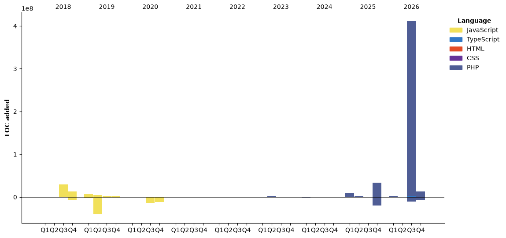

## Hi there 👋

<!--START_SECTION:waka-->


**🐱 My GitHub Data** 

> 📦 351.1 kB Used in GitHub's Storage 
 > 
> 🏆 1,186 Contributions in the Year 2026
 > 
> 🚫 Not Opted to Hire
 > 
> 📜 19 Public Repositories 
 > 
> 🔑 12 Private Repositories 
 > 
**I'm a Night 🦉** 

```text
🌞 Morning                3679 commits        ███░░░░░░░░░░░░░░░░░░░░░░   11.12 % 
🌆 Daytime                12183 commits       █████████░░░░░░░░░░░░░░░░   36.82 % 
🌃 Evening                10181 commits       ████████░░░░░░░░░░░░░░░░░   30.77 % 
🌙 Night                  7044 commits        █████░░░░░░░░░░░░░░░░░░░░   21.29 % 
```
📅 **I'm Most Productive on Tuesday** 

```text
Monday                   5908 commits        ████░░░░░░░░░░░░░░░░░░░░░   17.86 % 
Tuesday                  6518 commits        █████░░░░░░░░░░░░░░░░░░░░   19.70 % 
Wednesday                5710 commits        ████░░░░░░░░░░░░░░░░░░░░░   17.26 % 
Thursday                 4819 commits        ████░░░░░░░░░░░░░░░░░░░░░   14.56 % 
Friday                   4350 commits        ███░░░░░░░░░░░░░░░░░░░░░░   13.15 % 
Saturday                 3214 commits        ██░░░░░░░░░░░░░░░░░░░░░░░   09.71 % 
Sunday                   2568 commits        ██░░░░░░░░░░░░░░░░░░░░░░░   07.76 % 
```


📊 **This Week I Spent My Time On** 

```text
🕑︎ Time Zone: America/New_York

💬 Programming Languages: 
TypeScript               49 mins             ██████████████░░░░░░░░░░░   55.71 % 
TSConfig                 29 mins             ████████░░░░░░░░░░░░░░░░░   33.92 % 
Text                     3 mins              █░░░░░░░░░░░░░░░░░░░░░░░░   03.83 % 
Other                    2 mins              █░░░░░░░░░░░░░░░░░░░░░░░░   02.71 % 
JavaScript               1 min               █░░░░░░░░░░░░░░░░░░░░░░░░   02.25 % 

🔥 Editors: 
Cursor                   1 hr 28 mins        █████████████████████████   100.00 % 
Codex Vscode             0 secs              ░░░░░░░░░░░░░░░░░░░░░░░░░   00.00 % 

💻 Operating System: 
Mac                      1 hr 28 mins        █████████████████████████   100.00 % 
```

🤖 **AI Coding This Week** 

```text
⏱ AI Coding Time: 33 mins (38.24%)

✍️ 0 lines written by AI, 42 lines written by hand (0.0% AI-written)

🔤 16,150 Input Tokens, 302 Output Tokens

💵 $0.05 Estimated AI Cost This Week

🧠 5 AI Sessions, 10 AI Prompts

Grok                     52 lines            █████████████████████████   100.00 % 
GPT                      0 lines             ░░░░░░░░░░░░░░░░░░░░░░░░░   00.00 % 

🔎 AI Coding Insights:
🧑‍💻 Mostly Hands-On — 0.0% of written lines came from AI
📝 Concise Prompter — average 237 characters per prompt
🔁 Iterative Prompter — average 2 prompts per session
🔍 Hands-On Reviewer — 100.0% of changed lines were hand-edited
```

**I Mostly Code in JavaScript** 

```text
JavaScript               25 repos            ████████████░░░░░░░░░░░░░   48.08 % 
PHP                      12 repos            ██████░░░░░░░░░░░░░░░░░░░   23.08 % 
TypeScript               7 repos             ███░░░░░░░░░░░░░░░░░░░░░░   13.46 % 
CSS                      5 repos             ██░░░░░░░░░░░░░░░░░░░░░░░   09.62 % 
Nunjucks                 1 repo              ░░░░░░░░░░░░░░░░░░░░░░░░░   01.92 % 
```


**Timeline**




 Last Updated on 01/11/2026 18:51:09 UTC
<!--END_SECTION:waka-->

<!--
**wilbertcaba/wilbertcaba** is a ✨ _special_ ✨ repository because its `README.md` (this file) appears on your GitHub profile.

Here are some ideas to get you started:

- 🔭 I’m currently working on ...
- 🌱 I’m currently learning ...
- 👯 I’m looking to collaborate on ...
- 🤔 I’m looking for help with ...
- 💬 Ask me about ...
- 📫 How to reach me: ...
- 😄 Pronouns: ...
- ⚡ Fun fact: ...
-->
